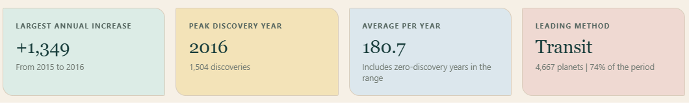
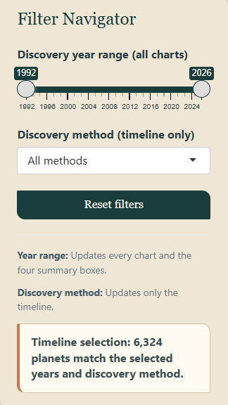

# NASA Exoplanet Field Guide

An interactive R Shiny dashboard for exploring confirmed planets in the NASA
Exoplanet Archive. The project turns a large scientific catalogue into a guided
story about discovery growth, detection methods, planetary characteristics and
the limits of the available evidence.



## Project overview

The analysis uses the **Planetary Systems Composite Parameters** table from the
[NASA Exoplanet Archive](https://exoplanetarchive.ipac.caltech.edu/cgi-bin/TblView/nph-tblView?app=ExoTbls&config=PSCompPars).
The documented snapshot was downloaded on **30 July 2026** and contains:

- 6,324 confirmed planets
- 4,738 host systems
- 11 recorded discovery methods
- discovery years from 1992 to 2026

The dashboard is designed for a non-technical audience while retaining the
scientific context and limitations of the source data.

## Dashboard sections

| Section | Purpose |
| --- | --- |
| Overview | Introduces the scale, coverage and major patterns in the archive. |
| Discovery Trends | Explores annual discoveries, detection methods and facilities with interactive filters. |
| Planet Characteristics | Compares radius, orbital period, distance, eccentricity and received starlight. |
| Data Explorer | Provides searchable records, a selected-planet profile and CSV download. |
| Key Findings | Summarises the strongest patterns, caveats and interpretation. |



## Selected findings

- **2016 is the busiest complete discovery year** in the snapshot, with 1,504
  confirmed planets.
- **Transit is the leading recorded method**, accounting for 4,667 planets
  (73.8%). This reflects detection geometry, survey design and confirmation
  practices rather than the true distribution of planets in the galaxy.
- **Short orbital periods dominate the measured sample:** 5,326 of 5,981
  planets with reported periods orbit in less than one Earth year.
- **Nearly circular reported orbits form the largest eccentricity group:**
  4,002 of 5,273 measured values are below 0.1, although missing and assumed
  values limit interpretation.

## Technology

- R and Shiny
- data.table and dplyr for data preparation
- ggplot2 for analytical graphics
- DT for the searchable data explorer
- HTML and CSS for the field-guide interface

## Repository structure

```text
NASA-Exoplanet-Field-Guide/
├── README.md
├── requirements.R
├── .gitignore
├── app/
│   ├── app.R
│   └── data/
│       └── README.md
├── assets/
│   ├── filter_navigator.png
│   └── summary_cards.png
└── docs/
    ├── dashboard_snapshot.html
    ├── NASA_Exoplanet_Field_Guide.pdf
    └── NASA_Exoplanet_Field_Guide.docx
```

The local `app/data/nasa_exoplanets.csv` file is intentionally excluded from
Git because it is approximately 81 MB.

## Run locally

1. Install a recent version of R. RStudio is optional.
2. Clone or download this repository.
3. Open R in the repository root and install the required packages:

   ```r
   source("requirements.R")
   ```

4. Follow the instructions in [`app/data/README.md`](app/data/README.md) to add
   the NASA CSV.
5. Start the dashboard:

   ```r
   shiny::runApp("app")
   ```

The application opens in the default web browser.

## Reports and static preview

- [Project report (PDF)](docs/NASA_Exoplanet_Field_Guide.pdf)
- [Editable report (Word)](docs/NASA_Exoplanet_Field_Guide.docx)
- [Static dashboard snapshot](docs/dashboard_snapshot.html) — download and open
  locally for the best viewing experience

## Method and interpretation

The app loads 22 fields from the source table. Missing measurements are
excluded only from calculations that require them, allowing valid observations
to remain available elsewhere in the dashboard. Stellar distance is converted
from parsecs to light-years, and planetary measurements are presented in
Earth-relative units where possible.

The results describe the **recorded confirmed-planet archive**, not the complete
planetary population. Detection geometry, survey targeting, instrument
sensitivity, confirmation procedures, missing measurements and the incomplete
2026 observation period all shape the visible patterns. Similar radius and
received starlight are not treated as proof of habitability.

## Author

Alpaycan Cabbar
